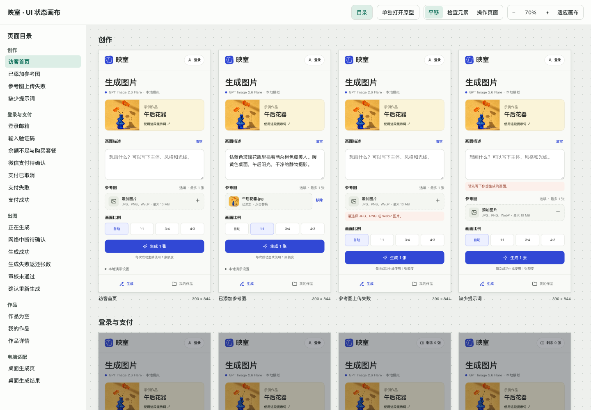
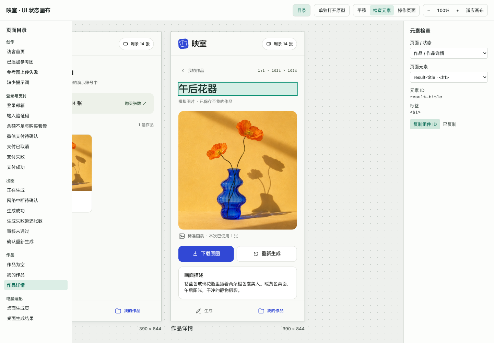

<!-- 用途：介绍和安装 UI State Board，展示映室实测用例。作为仓库入口单独维护；执行规则见技能说明，案例启动细节见示例说明。安装方式、模板接口或展示效果变化时同步更新。 -->
# UI State Board

**Design-then-Code，先用图定调，再用代码落地。**

直接让 Codex 这类代码模型从文字写前端，功能很快就能跑起来。静态页面的视觉探索空间容易受限，版式、配色和细节常常长得很像，一眼就有「AI 味」。

这个 Skill 把视觉探索和前端实现接起来。图像生成模型擅长出不同的构图、配色和质感，先用它做整屏设计稿，挑出想要的视觉方向。再让代码模型照着设计稿还原页面，用 HTML/CSS/JS 或项目现有组件把布局、状态和交互落地。

画布负责评审和交付。它加载同一份前端代码，把不同状态按页面分组，方便跳转、操作和检查元素。点「复制组件 ID」，就能把具体元素的位置连同修改意见发给 AI。

**[在线体验映室画布](https://wwzzb.github.io/ui-state-board/board/)** · 打开即能浏览 22 个状态，试用左侧目录和「复制组件 ID」。

## 安装

在项目目录运行以下命令安装。

```sh
npx skills add wWzZb/ui-state-board
```

如果希望在所有 Codex 项目中使用，可以选择全局安装。

```sh
npx skills add wWzZb/ui-state-board -a codex -g
```

打开项目后调用 `$ui-state-board`。例如：

> 用 $ui-state-board 把这个项目的生成页、支付弹窗和结果页接进评审画布。手机视口用 390 × 844，复用现有前端，完成后打开浏览器。

## 实际用例 · 映室

映室是一个图片生成网页的本地演示。以前的评审稿里有 22 张状态图。这次把**同样的 22 个状态**接到画布里，覆盖创作、登录与支付、出图、作品和电脑适配。移动端画框使用 **390 × 844**，桌面端使用 **1280 × 844**。每个画框读取自己的演示数据，试用一个状态时，其他画框的草稿和余额不会跟着改变。



例如，在左侧点「作品详情」，进入「检查元素」并选中「午后花器」标题。点「复制组件 ID」，把下面三行连同修改要求发给 AI：

```text
页面名：作品
状态名：作品详情
元素 ID：result-title
```



可下载运行完整案例，或直接查看状态配置、页面代码与演示数据。[运行映室示例](examples/yingshi/README.md) · [22 个状态的配置](examples/yingshi/board.json) · [共用前端代码](examples/yingshi/app/main.js) · [评审数据](examples/yingshi/app/review.js)

## 工作方式

1. 先确定视口宽高，再梳理主流程和异常状态。每次评审的产物集中到项目根目录下的一个独立工作区。
2. 需要确认视觉方向时，先生成整屏设计稿，再用前端代码实现。复杂装饰用代码调整三轮仍有明显差距时，可把那一处单独做成 PNG 放回页面。
3. 给页面元素设置稳定的 ID，把状态名称和页面入口填进 `board.json`。画框直接渲染原页面，画布缩放时，页面内部的视口宽高保持固定。
4. 在浏览器交付画布。可以用「操作页面」试表单和按钮，或通过「检查元素」点选并复制组件 ID。配置了 `prototypeSrc` 时，工具栏可把原型单独打开。

以下节选自映室配置。「访客首页」和「已添加参考图」通过不同参数进入同一份页面：

```json
{
  "title": "映室 · UI 状态画布",
  "prototypeSrc": "../studio.html",
  "groups": [
    {
      "name": "创作",
      "viewport": { "width": 390, "height": 844 },
      "states": [
        { "name": "访客首页", "src": "../studio.html?review=guest" },
        { "name": "已添加参考图", "src": "../studio.html?review=reference-added" }
      ]
    }
  ]
}
```

画布使用原生 HTML、CSS 和 JavaScript，通过 HTTP 与页面在同一个站点运行。纯静态项目可用 Python 的本地服务器，默认端口为 `1104`。完整流程和可复用画布都随 Skill 安装。[技能说明](skills/ui-state-board/SKILL.md)
